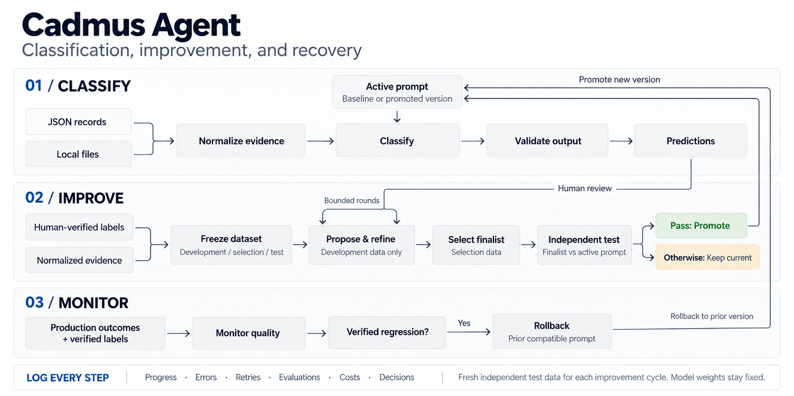
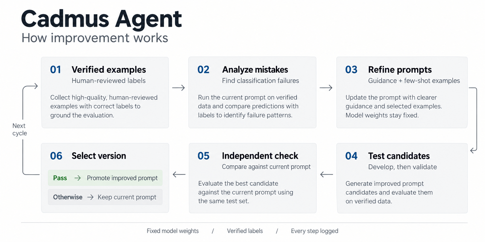

# Cadmus Agent

**Classify documents. Test better prompts. Keep only measured improvements.**

[](https://www.python.org/downloads/)
[](LICENSE)

A Python SDK and CLI that classifies documents and images, then tests prompt improvements against
human-verified answers. Bring JSON records or local files, connect a model, and keep control of what gets promoted.

**The model proposes. Verified labels and fixed evaluation rules decide.**

[Quick Start](#quick-start) · [How It Improves](#how-it-improves) · [SDK](#sdk) ·
[Usage Guide](docs/guide.md) · [License](#license)



## Why Cadmus?

Changing a prompt is easy. Knowing whether it actually got better is the hard part.

- **Use the data you have.** Classify mapped OCR, descriptions and metadata from JSON, or local images, text and PDFs.
- **Test instead of guessing.** Compare generated guidance and few-shot examples against trusted labels.
- **Keep the current version when evidence is weak.** Promotion requires independent evaluation and regression gates.
- **Inspect and recover.** Review predictions, prompt diffs and run reports; roll back after a verified quality drop.

> Prompt improvement, not model training. Model weights stay fixed. Classification needs no labeled dataset;
> reliable improvement needs trusted labels and fresh independent test data. Improvement is never guaranteed.

The project is **Cadmus Agent**; the package and CLI remain `ag-agent`, and the Python import is `ag_agent`.

## Quick Start

Requires **Python 3.11+** and an OpenAI-compatible model endpoint for real classification.
Run from the repository root. Examples use PowerShell; on macOS/Linux, replace
`.\.venv\Scripts\python` with `.venv/bin/python`.

### 1. Install

```powershell
python -m venv .venv
.\.venv\Scripts\python -m pip install -e ".[files]"
```

Omit `[files]` for JSON-only use. No API key yet? [Try the offline example](#try-it-offline).

### 2. Configure

Replace `YOUR_MODEL` with a model or deployment available at your provider:

```powershell
.\.venv\Scripts\python -m ag_agent init --label invoice --label receipt --model YOUR_MODEL --reviewer karim
```

This creates `ag-agent.toml` without overwriting an existing config. Export `OPENAI_API_KEY` through your local shell
or secret manager. Keys are not stored in the config, and `.env` files are not automatically loaded.

Edit the config to define your labels in `task.instructions` and `task.baseline_guidance`, and map your input fields.
For other endpoints, use `init --base-url ... --api-key-env ...`; see the [provider guide](docs/guide.md#model-providers).

### 3. Classify

The default JSON mapping expects records like these in `records.json`:

```json
[
  {"id": "doc-001", "text": "Invoice for consulting services"},
  {"id": "doc-002", "text": "Payment received for office supplies"}
]
```

```powershell
.\.venv\Scripts\python -m ag_agent doctor --check-connectivity
.\.venv\Scripts\python -m ag_agent inputs preview records.json --limit 2
.\.venv\Scripts\python -m ag_agent classify records.json --output predictions.json --summary-only
```

The connectivity check makes one small billable request. Classification sends mapped evidence to your provider;
review its data handling terms before using client documents.

Results include labels, statuses and explanations. Inspect `counts` and `rejected`: a completed batch can contain
failed or abstained documents. Exports refuse to overwrite existing files; `--summary-only` reduces stdout, not the
export. Use `--output-format jsonl` for one prediction per line.

### Prefer Local Images or PDFs?

Initialize with `--mode direct_files`, put files under the configured `documents` root, and classify that directory.
Use a vision-capable model for images and scanned PDFs. See the
[local-file walkthrough](docs/guide.md#working-with-local-files) and [input mappings](docs/guide.md#input-modes).
JSON mode does not open referenced originals; direct-file mode stays within allowed local roots.

## How It Improves



1. **Review answers.** A trusted reviewer confirms the correct labels; model guesses never become truth automatically.
2. **Separate the data.** Freeze document-family splits for development, selection and a sealed final gate.
3. **Try better prompts.** Generate and score guidance and few-shot variants using development data only.
4. **Choose and check.** Select one finalist, then compare it with the active prompt on the same independent gate batch.
5. **Promote or keep.** Replace the active prompt only if every required gate passes. Otherwise, keep the current version.

Classification and optimization are separate commands. To improve prompts, import reviewed labels, freeze a snapshot,
and run `optimize`. Review your thresholds and budgets before setting `policy.approved_for_live = true`.

[Run an improvement cycle](docs/guide.md#run-an-improvement-cycle) ·
[Explore the complete workflow](docs/guide.md#full-workflow)

### Safety Essentials

- **Ground truth stays separate.** Verified labels drive evaluation; they are not exposed as answers during inference.
- **The final test is not reusable.** Each later optimization cycle needs fresh independent gate data.
- **A better average is not enough.** Practical gain, statistical confidence, critical-class support and other gates apply.
- **Recovery needs evidence.** `monitor evaluate` can trigger rollback from delayed verified labels; schedule it externally.

These checks reduce risk; they do not guarantee accuracy. See [evaluation safeguards](docs/guide.md#evaluation-safeguards)
for the exact gates and [SECURITY.md](SECURITY.md) for data handling boundaries.

## SDK

```python
from ag_agent import Framework, load_config

with Framework(load_config("ag-agent.toml")) as fw:
    batch = fw.classify(["records.json"])
    for result in batch["results"]:
        print(result["name"], result["labels"], result["status"])
```

Inject custom model adapters and proposers without replacing the evaluation loop.
See [SDK extension points](docs/guide.md#sdk) for details.

## Try It Offline

Run the synthetic SDK walkthrough without credentials:

```powershell
.\.venv\Scripts\python examples/optimization/run_demo.py
```

The deterministic fake provider demonstrates orchestration, **not real-world accuracy**; it cannot read pixels.
There is also a [CLI walkthrough](docs/guide.md#try-it-offline).

## Documentation

| Topic | Guide |
| --- | --- |
| JSON records and local files | [Input modes and mappings](docs/guide.md#input-modes) |
| Reviewed labels and prompt evaluation | [Improvement cycles](docs/guide.md#run-an-improvement-cycle) |
| Provider settings and cost limits | [Model providers](docs/guide.md#model-providers) |
| Logs, reports and interrupted runs | [Observability](docs/guide.md#observability) |
| CLI commands | [Command reference](docs/guide.md#commands) |
| Tests and package structure | [Development](docs/guide.md#development) |

## Limitations

Local, single-host SDK/CLI, not a hosted service. No dashboard, HTTP API, built-in scheduler or model fine-tuning.
JSON accuracy depends on the evidence supplied. Duplicate grouping uses exact content hashes and family identifiers,
not semantic near-duplicate detection. See the [full limitations](docs/guide.md#limitations).

## License

MIT, copyright 2026 Karim Alameh. See [LICENSE](LICENSE).
