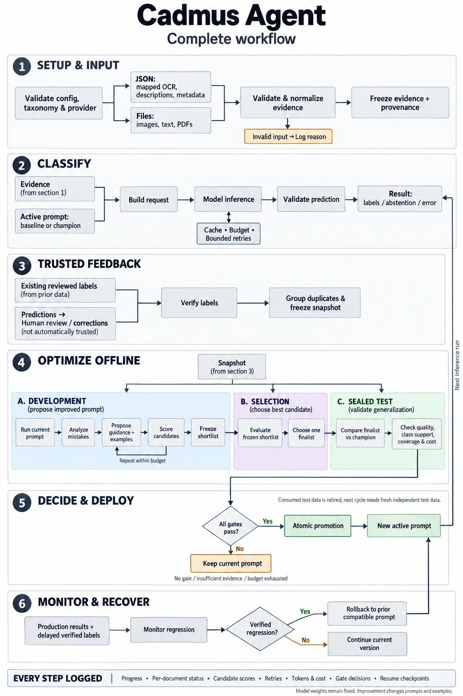

# Cadmus Agent Usage Guide

[Back to README](../README.md) · [Setup](#quick-start) · [Inputs](#input-modes) ·
[Evaluation](#evaluation-safeguards) · [Providers](#model-providers) · [Operations](#observability) ·
[SDK](#sdk) · [Commands](#commands) · [Development](#development)

Detailed configuration, evaluation and operational reference. Run shell commands from the **repository root**,
not from this `docs/` directory. The package and CLI are `ag-agent`; the Python import is `ag_agent`.

## Quick Start

Requires **Python 3.11+** and an OpenAI-compatible model endpoint for real classification.

### 1. Install

```powershell
python -m venv .venv
.\.venv\Scripts\python -m pip install -e ".[files]"   # omit [files] for JSON-only use
```

Run commands with `ag-agent ...` or, equivalently, `python -m ag_agent ...` (useful where policy blocks new
executables). Global options go before the command: `-c CONFIG`, `-v` (per-document events), `-q`, `--no-color`.

The setup examples use the virtual environment's interpreter explicitly on Windows. On macOS/Linux, use
`.venv/bin/python` instead. Install development tools separately with `python -m pip install -e ".[files,dev]"`.

### 2. Configure Your Classifier

Create a live configuration, not a demo. Replace `YOUR_MODEL` with a model or deployment available at your provider:

```powershell
.\.venv\Scripts\python -m ag_agent init --label invoice --label receipt --model YOUR_MODEL --reviewer karim
```

This writes `ag-agent.toml` in the current directory without overwriting an existing file or creating synthetic
records. For another project, put `-c path/to/ag-agent.toml` before `init`. Use `--client-id` for client isolation,
`--base-url` for another OpenAI-compatible endpoint, and `--api-key-env` to name its credential variable.

Export `OPENAI_API_KEY` in your local shell or inject it through your secret manager. Credentials are never written
to the config, and `.env` files are **not** automatically loaded. Do not send keys in chat or commit them.

### 3. Classify Your Data

The generated configuration expects JSON records in this shape. `ground_truth` is optional for classification
and is never included in model-visible evidence:

```json
[
  {"id": "doc-001", "text": "Invoice for consulting services", "ground_truth": ["invoice"]},
  {"id": "doc-002", "text": "Payment received for office supplies"}
]
```

Edit `[task]` to define what each label means in `instructions` and `baseline_guidance`. Edit `[input.json]` to map
your actual OCR, description and metadata fields. Preview before sending client data to a model:

```powershell
.\.venv\Scripts\python -m ag_agent doctor --check-connectivity
.\.venv\Scripts\python -m ag_agent inputs preview records.json --limit 2
.\.venv\Scripts\python -m ag_agent classify records.json --output predictions.json --summary-only
```

`doctor` exits with code 1 when storage, required dependencies, credentials, or the requested connectivity check fail.
The connectivity check sends one small billable request. Classification sends mapped evidence to the configured
provider; check its data handling terms first. No verified dataset or optimization is required to classify: the
configured baseline is used until a champion is promoted.

### Working With Local Files

For local images/PDFs/text, initialize a separate configuration with `--mode direct_files`, install the `files`
extra, and place your files under the generated `documents` allowed root (or change `input.roots`):

```powershell
.\.venv\Scripts\python -m ag_agent -c files.toml init --mode direct_files --label invoice --label receipt --model YOUR_MODEL --reviewer karim
.\.venv\Scripts\python -m ag_agent -c files.toml inputs preview documents --limit 2
.\.venv\Scripts\python -m ag_agent -c files.toml classify documents --output predictions.jsonl --output-format jsonl --summary-only
```

Exports refuse to overwrite existing files. JSON contains the full report; JSONL contains one prediction per line.
`--summary-only` reduces stdout, not the export. Rejected inputs remain in the stdout summary and run artifacts;
always inspect `counts` and `rejected`, since a completed batch can contain failed or abstained documents. Exports
can contain sensitive document names and model explanations; protect them like the original inputs.

## How It Improves


1. **Start with trusted answers.** Import examples whose labels have been confirmed by a configured reviewer.
2. **Freeze the experiment.** Split document families into development, selection and a sealed final gate.
3. **Try better instructions.** Generate and score guidance and few-shot variants using development data only.
4. **Choose one finalist.** Evaluate a frozen shortlist on selection data without feeding its scores back to the proposer.
5. **Check independently.** Compare the finalist with the current prompt on the same sealed gate batch, once.
6. **Promote or keep.** Replace the active version only if every required gate passes; otherwise leave it unchanged.

In the diagrams, "independent test" and "sealed test" refer to the final **gate** split used by the CLI.

### Run an Improvement Cycle

Classification and prompt optimization are separate operations. First establish accuracy on representative data.
Then configure critical labels, class definitions, promotion thresholds, reviewer identities, and realistic request
and cost limits. Set `policy.approved_for_live = true` only after reviewing those settings; initialization leaves it
false. Default thresholds are starting points, not certification of fitness for a client's workflow.

```powershell
.\.venv\Scripts\python -m ag_agent dataset import reviewed-records.json --verified-by karim
$snapshot = .\.venv\Scripts\python -m ag_agent dataset snapshot | ConvertFrom-Json
$run = .\.venv\Scripts\python -m ag_agent optimize $snapshot.snapshot_id | ConvertFrom-Json
.\.venv\Scripts\python -m ag_agent runs report $run.run_id
```

For direct files, import evidence first with `dataset import documents`, then import a separate label file with
`dataset import-labels labels.json --verified-by karim`. Only attest labels you have actually reviewed. Later
optimization cycles require fresh independent gate data; do not relabel model predictions as truth.

## Try It Offline

No API key required. The included synthetic dataset and deterministic provider let you explore the full lifecycle
before connecting a live model.

<details>
<summary>Run the credential-free CLI walkthrough</summary>

Use your virtual environment's Python for these commands; `python` below assumes that environment is active.

```powershell
cd examples/json_records
python -m ag_agent config validate
python -m ag_agent inputs preview records_batch1.json --limit 1          # exactly what the model sees
python -m ag_agent dataset import records_batch1.json --verified-by reviewer-1
python -m ag_agent dataset snapshot                                    # prints snapshot_id
python -m ag_agent optimize <snapshot_id>                              # live progress on stderr
python -m ag_agent runs report <run_id>                                # gates, costs, artifacts
python -m ag_agent classify records_batch2.json --summary-only         # uses the champion
python -m ag_agent dataset import records_batch2.json --verified-by reviewer-1
python -m ag_agent dataset snapshot                                    # old gate data is retired
python -m ag_agent optimize <new_snapshot_id>                           # may keep the current champion
```

</details>

Or run the SDK walkthrough from the repository root:

```powershell
.\.venv\Scripts\python examples/optimization/run_demo.py
```

The demo's `fake` provider follows keyword rules and cannot read pixels. Its "improvement" demonstrates
orchestration, **not real-world accuracy**. The `init` command configures a live provider instead.

## Input Modes

Choose one mode per configuration. Each mode has its own compatible prompt history and active champion.

| Mode | Reads | Input adapter boundaries |
| --- | --- | --- |
| `json_records` | Your JSON: OCR/extracted text, image descriptions, metadata, visual features | Does not open referenced originals or follow paths/URLs. Live inference still sends mapped evidence to your provider. |
| `direct_files` | Local images (png/jpg/jpeg/webp/bmp/tif/tiff), UTF-8 text (txt/md), PDFs under `input.roots` | Does not read outside allowed roots (symlinks resolved) or fetch remote files. Live inference sends normalized evidence to your provider. |

**JSON shapes:** `array` (`[{...}]`, optionally nested via `records_path`), `keyed` (`{"image.png": {...}}`),
`jsonl` (streamed). Fields are mapped explicitly; dotted paths reach nested values.

```toml
[input]
mode = "json_records"

[input.json]
shape = "keyed"                         # the key is the document id
text_fields = ["ocr.text"]
description_fields = ["vision.description"]   # rendered as "supplied description - not direct inspection"
feature_fields = ["vision.features"]
metadata_fields = ["meta"]
label_field = "ground_truth"            # routed to the label store; never model-visible
expose_id = false                       # names are identifiers unless explicitly exposed
```

See [../examples/json_records/keyed.toml](../examples/json_records/keyed.toml) and
[../examples/direct_files/ag-agent.toml](../examples/direct_files/ag-agent.toml). Malformed records, duplicate ids, wrong
field types, oversized fields and records with no usable evidence are rejected with per-item reason codes — never
silently dropped.

**Direct files:** EXIF orientation is applied, images are deterministically resized/re-encoded, PDFs use native text
where available and render scanned pages to images (`pdf_scan_strategy`). Page limits either reject or truncate
deterministically, and provenance records included/omitted pages. Corrupt/encrypted files fail with explicit codes.

Document families are kept together when splitting a snapshot. Use consistent identifiers or a mapped family field
to group alternate representations of the same document; defaults use the file-name stem. Each mode has its own
champion: a prompt's quality is not assumed to transfer.

## Evaluation Safeguards

| Risk | Safeguard |
| --- | --- |
| Learning from wrong answers | Only reviewer-verified labels enter snapshots. Corrections stay pending until a configured reviewer (not the submitter) verifies them. Model output is never ground truth. |
| Noise / lucky prompts | Seeded paired bootstrap over document families; promotion needs a minimum practical gain **and** a confidence lower bound above zero. |
| Overfitting the benchmark | Proposer sees development data only. Shortlist is frozen before selection; selection scores never flow back. Finalist meets the sealed gate once. |
| Reusing test data | Every family the optimizer touches is recorded; consumed gate families can never be a gate again, even after a crash. Later cycles need fresh labeled data. |
| Hidden regressions | Per-critical-class non-regression, coverage, invalid-response and (optional) cost-ratio gates. |
| Drift after release | `monitor evaluate` compares production predictions with delayed verified labels and rolls back to the previous compatible bundle. Provider outages are excluded, not blamed on the prompt. |
| Races | Promotion is a compare-and-swap against the champion captured at cycle start (`stale_incumbent` otherwise). |

The optimizer may change only the **classification guidance** and **few-shot example ids** (from development data).
Taxonomy, output schema, untrusted-content rule, model settings, metrics and policy are fixed per experiment.

<details>
<summary>Promotion gates, decisions and metric conventions</summary>

### Promotion Gates

`completeness` · `gate_group_support` · `critical_class_support` (→ `insufficient_evidence` when failing) ·
`absolute_floor` · `practical_gain` · `confidence_bound` · `critical_class_non_regression` · `coverage` ·
`invalid_rate` · optional `resource_ratio`. Every gate reports observed value, threshold and reason code.

Decisions: `promoted`, `rejected`, `insufficient_evidence`, `budget_exhausted`, `stale_incumbent`, `failed`,
`cancelled`. A first champion can also be registered with `prompts baseline <snapshot>` if the configured baseline
passes absolute gates on development+selection data.

### Metric Conventions

- Default primary metric: macro-F1 over taxonomy labels that occur in truth or predictions; zero division → 0.
- Abstentions, invalid responses and failures are counted in every denominator: they add false negatives for the
  true labels and no false positives. Answered-only accuracy is reported separately and never used for promotion.
- Multilabel: a valid empty set differs from abstention; exact match plus micro/macro-F1 are reported.
- Model-reported confidence is stored as uncalibrated metadata only.

</details>

## Full Workflow



Monitoring runs when you call `monitor evaluate`; schedule that command externally for recurring checks.
Automatic rollback depends on configured thresholds and enough delayed verified labels.

## Model Providers

`openai_compatible` posts to `{base_url}/chat/completions` (OpenAI, Azure OpenAI v1-style endpoints, and many local
servers) with images as data URLs and structured JSON output.

```toml
[provider]
kind = "openai_compatible"
base_url = "https://api.openai.com/v1"
model = "<multimodal model>"
api_key_env = "OPENAI_API_KEY"         # auth_header = "api-key" for Azure-style keys
structured_output = "json_schema"      # or json_object / none
pricing = { input_per_1k = 0.0, output_per_1k = 0.0 }   # set real prices to enforce optimizer.max_cost_usd

[policy]
approved_for_live = true   # required: optimize refuses live providers until you set thresholds deliberately
```

Optimization with a live provider refuses to start until `policy.approved_for_live = true`. The demo thresholds are
illustrations; choose critical labels, floors, minimum gain and supports from the client's risk tolerance. Use
`doctor --check-connectivity` for an explicit one-request live check. Retries apply only to transient errors with
exponential backoff and jitter; every attempt is ledgered and budgeted. Timed-out requests are recorded as unknown
(possibly charged), so exact invoice caps cannot be guaranteed.

## Observability

Every run writes ordered, structured events to SQLite (authoritative) and `data_dir/logs/<client>/<run_id>.jsonl`
(rotating export, re-synced from the database after failures). Progress goes to stderr; results go to stdout as JSON.

```powershell
python -m ag_agent runs list
python -m ag_agent runs logs <run_id> --follow                      # works after the run ended too
python -m ag_agent runs logs <run_id> --stage final_gate --format jsonl
python -m ag_agent runs logs <run_id> --document <doc-id> --level DEBUG
python -m ag_agent runs logs <run_id> --candidate r1c2
python -m ag_agent runs report <run_id>                             # decision, request ledger, warnings, artifacts
python -m ag_agent runs resume <run_id>                             # reuses completed predictions
```

Event fields: `schema_version, event_id, timestamp (UTC), sequence, level, event_type, run_id, stage, status,
message`, plus applicable allowlisted fields (document/candidate/bundle/snapshot ids, attempt, durations, tokens,
cost, cache hit, budget remaining, error and reason codes). Content (OCR text, prompts, images, file paths, secrets)
is never logged; per-record predictions, evaluation records, decision reports and candidate diffs are protected run
artifacts under `data_dir/runs/<client>/<run_id>/`.

**Troubleshooting a failed document:** `runs logs RUN --document DOC --level DEBUG` shows request preparation,
each provider attempt (error code, retry delay), validation and the terminal status.
**Troubleshooting a rejected promotion:** `runs logs RUN --stage final_gate` lists each gate with observed value and
threshold; `runs report RUN` includes `decision.json` and candidate diffs (`prompts diff A B`).

Exit codes: `0` completed (including non-promotion), `1` execution failure, `2` configuration/access, `3` input
validation, `4` audit persistence failure (work stops, champion unchanged), `130` cancelled.

## SDK

```python
from ag_agent import Framework, load_config

with Framework(load_config("ag-agent.toml"), subscribers=[print]) as fw:
    batch = fw.classify(["records.json"])
    for result in batch["results"]:
        print(result["name"], result["labels"], result["status"])
```

With reviewed labels and an approved live policy, run the same improvement cycle from Python:

```python
from ag_agent import Framework, load_config

with Framework(load_config("ag-agent.toml")) as fw:
    fw.import_dataset(["reviewed-records.json"], verified_by="karim")
    snapshot = fw.snapshot()
    decision = fw.optimize(snapshot["snapshot_id"])["decision"]
```

Inject custom components: `Framework(cfg, model=..., proposer=..., proposer_model=...)`. A `Proposer` receives only
a `DevelopmentView`. Built-ins: `ModelProposer` (LLM rewrites guidance from development failures) and
`HeuristicProposer` (deterministic, used with the fake provider).

## Commands

`config validate` · `inputs validate|preview` · `dataset import|import-labels|snapshot|inspect|list` · `classify` ·
`evaluate` (`--split gate` consumes that gate) · `optimize` · `corrections add|verify|reject|list` ·
`prompts list|show|diff|baseline|rollback` · `runs list|show|logs|report|resume|prune` · `monitor evaluate` ·
`init` · `doctor` · `demo init`.

## Development

```powershell
.\.venv\Scripts\python -m pip install -e ".[files,dev]"
.\.venv\Scripts\python -m pytest
.\.venv\Scripts\python -m ruff check src tests examples
.\.venv\Scripts\python -m mypy
```

Bug reports are most useful with a minimal sanitized input, configuration without credentials, the command used,
and relevant reason codes. Never attach client documents, API keys, or private run artifacts to a public issue.
See [../SECURITY.md](../SECURITY.md) for data handling and deployment boundaries.

<details>
<summary>Package architecture</summary>

```text
src/ag_agent/
  contracts.py    typed models (evidence, predictions, bundles, reports, decisions)
  config.py       validated TOML config, compatibility/pipeline identities
  inputs.py       InputAdapter: JsonRecordAdapter, DirectFileAdapter
  documents.py    text/image/PDF extraction and provenance
  tasks.py        taxonomy, output contract, parsing, metrics
  providers.py    ModelAdapter: FakeModel, OpenAICompatibleModel
  prompting.py    fixed / mutable / examples / untrusted-evidence composition
  inference.py    budgets, ledger, retries, caching, progress
  datasets.py     labels lifecycle, snapshots, exposure ledger
  evaluation.py   reports, paired family bootstrap
  optimization.py proposers and the bounded cycle
  policy.py       promotion gates
  registry.py     bundles, champions, compare-and-swap, rollback
  observability.py events, JSONL export, console/subscribers
  storage.py      SQLite migrations, content-addressed artifacts
  runtime.py      Framework SDK facade
  cli.py          Typer CLI
```

</details>

## Limitations

- Improvement is not guaranteed. Each cycle needs fresh, independently labeled gate data; a small fixed benchmark
  cannot support indefinite self-improvement.
- Labels still need a trustworthy source. Automation removes prompt-tuning work, not the need to define "correct".
- JSON-only accuracy is bounded by what the stored OCR, descriptions and metadata preserve.
- Single-host local deployment; no HTTP API, dashboard, scheduler daemon, remote fetching, fine-tuning, model or
  hyperparameter search, or autonomous taxonomy changes. Run `monitor evaluate` from an external scheduler.
- Near-duplicate detection is limited to exact content hashes and family ids (file-name stem or a mapped field).

## License

MIT, copyright 2026 Karim Alameh. See [../LICENSE](../LICENSE).
